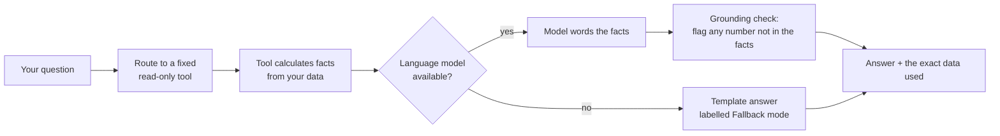
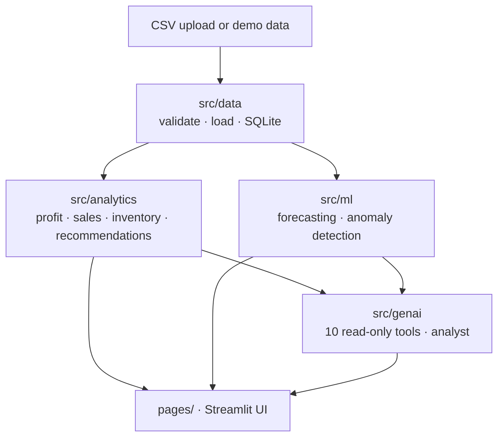

# VyaparAI – The AI Business Copilot for Small Businesses

> **Turn Your Business Data Into Smarter Decisions.**

<div align="center">


# VyaparAI

### The AI Business Copilot for Small Businesses
**Turn your business data into smarter decisions.**


[Quick start](#-quick-start-5-minutes) ·
[Use your own CSV](#-use-your-own-data) ·
[Features](#-what-you-get) ·
[AI analyst](#-ai-business-analyst-free-local-model) ·
[Troubleshooting](#-troubleshooting)

</div>

---

## 👋 What is VyaparAI?

Most small shops write down every sale and every stock count, yet still get surprised: a best-seller runs out, a product quietly sells **below cost**, discounts eat the margin, cash is stuck in goods nobody buys.

**VyaparAI reads your sales and stock files and tells you, in plain language:**

| 🛒 You ask | 💡 VyaparAI answers |
|---|---|
| What should I reorder this week? | Exact products and quantities, with the reason |
| Which products lose me money? | Items whose gross profit is negative, and why |
| Where do my discounts hurt? | Discount levels that erase the margin |
| How much will I sell next week? | 7 or 30 day forecast with an honest accuracy check |
| Is anything strange in my records? | Flagged bills and prices that need a second look |

### 🆓 Free, private, rupee-first

- 💰 **Every amount is in ₹**, grouped the Indian way (₹12,34,567 · ₹1.30 Cr).
- 🔒 **Runs on your own computer.** Your data never leaves it.
- 🧾 **No paid service.** No OpenAI, no Anthropic, no Gemini, no API keys, no cloud database, no hosting fee.
- 🧠 **The AI chat uses a free open-weight model** (Ollama or Hugging Face) running locally. Without one, the chat still works using clearly labelled template answers.

> ⚠️ **The built-in demo data is synthetic** (a fictional Indian kirana store). Nothing you see with it is a real business result.

---

## 🚀 Quick start (5 minutes)

**You need:** Python 3.11 or newer and about 1 GB of disk space.

<details open>
<summary><b>🪟 Windows (PowerShell)</b></summary>

```powershell
cd vyaparai
python -m venv .venv
.\.venv\Scripts\Activate.ps1
pip install -r requirements.txt
streamlit run app.py
```
</details>

<details>
<summary><b>🐧 Linux / 🍎 macOS</b></summary>

```bash
cd vyaparai
python3 -m venv .venv
source .venv/bin/activate
pip install -r requirements.txt
streamlit run app.py
```
</details>

Then open **http://localhost:8501**. Demo data loads by itself on the first start (and only once). The sidebar always tells you whether you are looking at **Demo data** or **Your uploaded data**.

> 💡 Optional: copy `.env.example` to `.env` to change settings. No keys are needed.

---

## 📂 Use your own data


> **Short version:** open **Data Management** in the sidebar → upload your CSV → check the column matching → confirm.

### Step by step

| # | Do this | What happens |
|:-:|---|---|
| 1️⃣ | Export your sales (and optionally stock and purchases) as **CSV** from your billing software or Excel | |
| 2️⃣ | Open **Data Management → Upload CSV files** | |
| 3️⃣ | Choose your file(s) | Column names are matched automatically (`Qty`, `Rate`, `SKU`, `Bill Date` …) |
| 4️⃣ | Fix any wrong match from the dropdowns | |
| 5️⃣ | Read the **validation report** | Bad rows are listed with a reason and can be downloaded, never silently dropped |
| 6️⃣ | Confirm | Your data becomes the active dataset in every page. Demo data stays safely separate |

### Which files do I need?

| File | Needed? | Unlocks |
|---|---|---|
| 🧾 **Sales** | ✅ Required | Revenue, profit, trends, discounts, forecasts, anomalies |
| 📦 **Inventory** | Optional | Reorder points, stock-out risk, slow and dead stock |
| 🚚 **Purchases** | Optional | Stock already on order (avoids double-ordering) |

### Minimum columns in the sales file

| Column | Example | Notes |
|---|---|---|
| `transaction_date` | `2026-01-05` or `05/01/2026` | Day-first dates are read as day/month/year |
| `product_id` | `SKU-1042` | Your item code |
| `quantity` | `3` | **Negative = customer return** |
| `unit_price` | `₹ 1,250` | In rupees, before discount. `₹`, `Rs` and commas are cleaned automatically |

**Nice to have:** `unit_cost` (needed for profit and margin; leave blank if unknown), `discount` (a percentage, 0–100), `total_amount`, `product_name`, `category`, `payment_method`, `transaction_id`.

**Inventory file:** `product_id` and `current_stock` are required. `reorder_level`, `supplier_lead_time_days`, `unit_cost` are optional.
**Purchases file:** `purchase_date`, `product_id`, `quantity_purchased` are required. Dates after your last sale count as *stock on order*.

📖 Full column list: [`docs/DATA_DICTIONARY.md`](docs/DATA_DICTIONARY.md). Want a template? **Data Management** has a button to download the demo CSVs; copy their headers.

### Good to know

- 🧮 An **unknown cost is never treated as zero.** It is estimated from inventory cost (and flagged) or left out of margin figures. The app shows how much of your revenue has a known cost.
- 🔁 **Exact duplicate lines** are flagged and excluded from the numbers.
- 📏 Files up to **50 MB** are accepted (change `maxUploadSize` in `.streamlit/config.toml`).
- 📈 Forecasts need about **28 days** of sales history per product.

---

## ✨ What you get

The sidebar has 8 sections:

| | Section | What it does |
|:-:|---|---|
| 🏠 | **Overview** | Revenue, cost of goods, **gross** profit and margin, low-stock and slow-moving counts, stock value, anomaly count, trends, top products, alerts and ranked recommendations |
| 📊 | **Sales Analytics** | Daily, weekly, monthly trends, product and category rankings, discount analysis, period comparison, declining products, CSV export |
| 📦 | **Inventory Intelligence** | Reorder point, safety stock, suggested order quantity, stock-out risk, slow, dead and excess stock, promotion candidates, editable thresholds |
| 🔮 | **Demand Forecasting** | 7 or 30 day forecasts. Two simple baselines compete against a Random Forest; the ML model is used only if it clearly wins |
| 🕵️ | **Profit Leakage Detection** | Data errors, statistical oddities and business risks, each with severity, the expected value and a next step |
| 🤖 | **AI Business Analyst** | Ask in plain English. Numbers come from code, the model only words them |
| 🗂️ | **Data Management** | Upload, column mapping, validation report, rejected rows, reset to demo |
| ⚙️ | **Settings & Model Status** | Data quality, AI model status, thresholds, backup |

---

## 🤖 AI Business Analyst (free local model)


The app **works fully without this**. Add it only if you want conversational answers. The model is not bundled; you download it once.

### Option A · Ollama (recommended)

```bash
# 1. Install Ollama (free) from https://ollama.com
# 2. Download a model (about 2 GB)
ollama pull llama3.2:3b          # low RAM? try llama3.2:1b or qwen2.5:1.5b
# 3. Start the server (skip if the Ollama desktop app is already running)
ollama serve
```
Reload the **AI Business Analyst** page. The badge turns green and shows the model name. To use a different model, set `OLLAMA_MODEL` in `.env`.

### Option B · Hugging Face model, run locally

```bash
pip install -r requirements-hf.txt
```
In `.env` set `VYAPARAI_LLM_BACKEND=huggingface`. The default `Qwen/Qwen2.5-0.5B-Instruct` is small and free (public models need no account or token). It is fast on a CPU but less fluent than a 3B model.

### 🛡️ Why you can trust the answers



1. The model **cannot run SQL, code or commands**, change stock or place orders. It can only call 10 fixed read-only tools, and their arguments are validated.
2. Every number comes from calculated data, labelled *observed*, *estimate* or *recommendation*.
3. Numbers in the answer that are not in the data are **flagged**.
4. The exact data used is shown under every answer.

---

## 🧠 How it works



UI, data access, business logic, ML and AI are separate layers. Every page calls the same functions, so each number is calculated in exactly one place.

<details>
<summary><b>📁 Project layout</b></summary>

```
vyaparai/
├── app.py                  Streamlit entry point (sidebar navigation)
├── config.py               Settings and business-rule thresholds
├── pages/                  The 8 app sections
├── src/
│   ├── data/               validator, loader, SQLite repository, demo generator
│   ├── analytics/          profitability, sales, inventory, recommendations
│   ├── ml/                 forecasting, evaluation, anomaly detection
│   ├── genai/              business tools, analyst, Ollama / Hugging Face clients
│   ├── ui/                 theme, shared components, cached state
│   └── utils/              rupee formatting, date parsing, logging
├── data/                   demo CSVs (database is created here on first run)
├── docs/                   data dictionary, demo scenarios, hackathon pitch
├── scripts/                demo data generator
└── tests/                  139 automated tests
```
</details>

<details>
<summary><b>🧰 Technology (all free and open source)</b></summary>

Python 3.11+ · Streamlit · Pandas · NumPy · Plotly · scikit-learn (Random Forest, Isolation Forest) · SQLite · pytest · Ollama *or* Hugging Face `transformers` (optional).
</details>

### 📐 Key definitions

| Term | Meaning |
|---|---|
| **Revenue** | Recorded line total after discount; returns count as negative |
| **Gross profit** | Revenue − cost of goods sold. **Not net profit**: rent, salaries and other costs are not in the data |
| **Gross margin %** | Gross profit ÷ revenue of items with a known cost × 100 |
| **Safety stock** | z × std. dev. of daily demand × √lead time |
| **Reorder point** | Demand during supplier lead time + safety stock |
| **Suggested order** | Order-up-to level − stock on hand − stock on order (never below zero) |
| **Exposure** | An *estimate* of money at risk, with overlaps counted once. Not a promised saving |

---

## 🧪 Run the tests

```bash
python -m pytest
```
139 tests cover validation, profit maths, reorder logic, forecast validation, leakage guards, anomaly detection, recommendations, tool validation and the no-Ollama fallback. They need no internet and no language model.

---

## 🗄️ Database

A local SQLite file at `data/vyaparai.db`, created on first run. Demo and uploaded rows share the tables and are separated by a `dataset` column.

| Want to… | Do this |
|---|---|
| Back up | **Settings → Create backup** (saved in `data/backups/`) |
| Start fresh | **Settings → Erase ALL stored data** (asks to confirm), or delete the file |
| Reload demo data | **Data Management → Reset to demo data** |

---

## 🩺 Troubleshooting

| Problem | Fix |
|---|---|
| Chat says **Fallback mode** | Ollama is not running or no model is pulled. Run `ollama serve` and `ollama pull llama3.2:3b`, then check **Settings → Model status** |
| AI is slow or times out | Use a smaller model (`llama3.2:1b`) or raise `VYAPARAI_LLM_TIMEOUT` in `.env` |
| `ModuleNotFoundError` | Activate the virtual environment, then `pip install -r requirements.txt` |
| Rows rejected on upload | Open the validation report, download the rejected rows, fix them, upload again |
| Forecast says "not enough history" | Needs 28+ days of sales (about 12 weeks for ML validation) |
| Numbers look stale after replacing the DB file | Restart the app (analyses are cached) |
| Port 8501 is busy | `streamlit run app.py --server.port 8502` |

---

## ⚖️ Honest limitations

- 🔮 Forecasts are **estimates, not guarantees**. Festivals, promotions and price changes are not modelled, and days when an item was out of stock look like zero demand.
- 🚩 Anomalies are **flags for review, not proof of fraud**. Many are legitimate (bulk orders, price changes).
- 📦 Reorder advice is based on recent sales. It does not know supplier minimums, shelf life or your cash limit. VyaparAI never changes stock or buys anything.
- 💬 Small local language models can phrase things imperfectly. That is why numbers come from code and are shown beside every answer.
- 🧪 The Ollama and Hugging Face paths are covered by mocked tests; try the chat once on your own machine.

## 🔐 Privacy and security

All data stays on your computer. Nothing is sent to a cloud service (the one-time Hugging Face model *download* contacts huggingface.co). Logs never contain data rows or prompts.

The app has **no login**. It is built for one user on a trusted machine. Do not put it on a public network without adding authentication.

---

## 📚 More documentation

| Document | What's inside |
|---|---|
| [`docs/DATA_DICTIONARY.md`](docs/DATA_DICTIONARY.md) | Every column, type and meaning |
| [`docs/DEMO_SCENARIOS.md`](docs/DEMO_SCENARIOS.md) | The problems planted in the demo data and where to find them |
| [`docs/HACKATHON_PITCH.md`](docs/HACKATHON_PITCH.md) | Pitch, 3-minute demo script, judge Q&A |

<div align="center">

**Made for the dukaandaar who knows the shop, and wants the numbers to keep up.**

</div>
